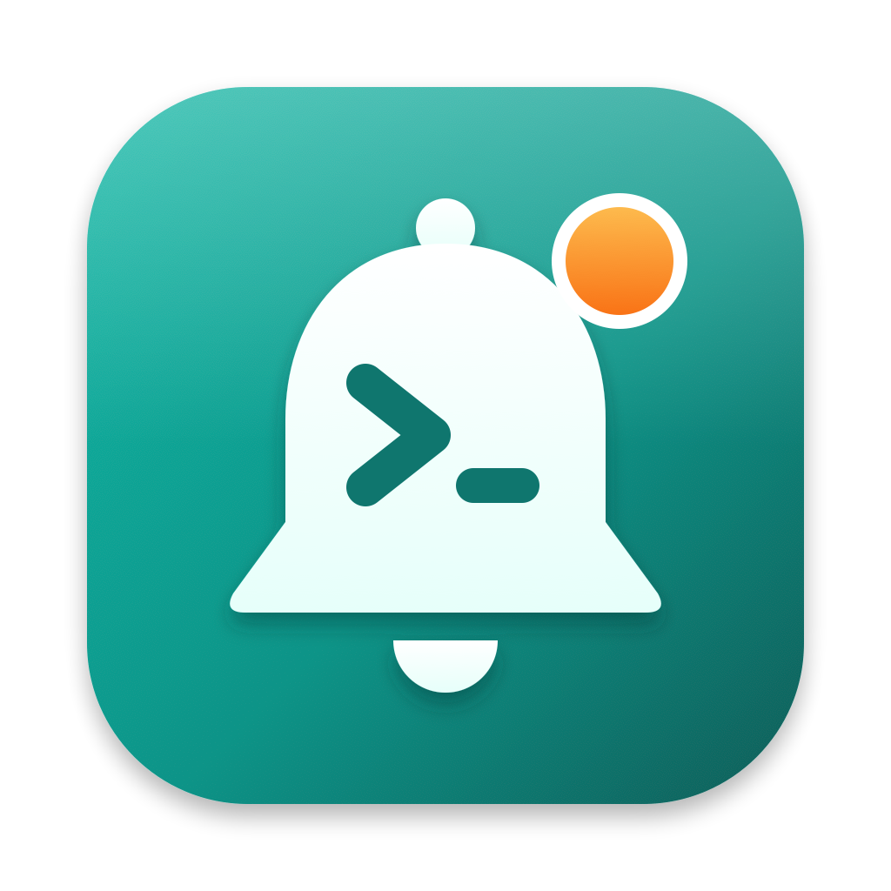

# Notifier Builder

[](https://www.buymeacoffee.com/russcollis)

If this app saved you time or gave you a foundation to work from, please consider buying me a coffee - cheers :)

<p align="center"></p>

A macOS app for designing, previewing and generating commands for [Jamf Notifier](https://github.com/Jamf-Concepts/Notifier) notifications. Matches the Notifier **4.0.1** command-line spec.

**Version:** 1.3.0
**Owner:** Russell Collis

## Features

- **Live preview:** see how your alert or banner will look on a macOS desktop as you edit it.
- **Notification options:** set the type (persistent alert or temporary banner), title, subtitle, message, sound (defaults to no sound) and remove behaviour (`--remove prior` / `--remove all`).
- **Buttons and actions:** primary and secondary buttons (`--messagebutton`, `--messagebutton2`) with their actions, plus body-click (`--messageaction`) and dismiss (`--messagedismissaction`) actions. Actions can use Notifier's `{loggedInUser}` placeholder.
- **Rebranding:** pick a preset icon, or click **Browse…** to choose your own PNG or ICNS image for `--rebrand`. Notifier 4.x rebrands and then exits, so the builder outputs the rebrand as its own `sudo` command before the notification.
- **macOS 26.4+ icon fix:** from macOS 26.4, notifications ignore the icon `--rebrand` sets ([Notifier issue #34](https://github.com/Jamf-Concepts/Notifier/issues/34)). Tick **Apply macOS 26.4+ icon fix** to add a step that writes the image into Notifier's helper apps, removes `CFBundleIconName`, ad-hoc re-signs the helpers and restarts the notification daemons. Re-run it after updating Notifier.
- **Templates:** start from documentation examples or enterprise MDM presets.
- **Code inspector:** generates the matching Notifier command (single line, multiline or a Jamf Pro policy script), and can parse a pasted command or script back into the editor.
- **Live test:** post a real macOS system notification, or run the installed Jamf Notifier binary with your settings.
- **Sound audition:** preview the selected macOS system sound.

## Install

Download `NotifierBuilder-1.3.0.pkg` from this repo and open it. It installs **Notifier Builder.app** into `/Applications`. The app and package are signed with Developer ID and notarized by Apple. Requires macOS 27.2 or later.

To test notifications for real you also need [Jamf Notifier 4.0.1](https://github.com/Jamf-Concepts/Notifier/releases) installed in `/Applications/Utilities`.

## Build from source

Requires Xcode. To build the app and an installer package:

```bash
./build_installer.sh
```

This builds the Release configuration and writes `NotifierBuilder-<version>.pkg` next to the script.

To wrap a notarized app in a signed, notarized disk image:

```bash
./make_dmg.sh "/path/to/Notifier Builder.app"
```

## License

MIT © 2026 Russell Collis — see [LICENSE](LICENSE).
